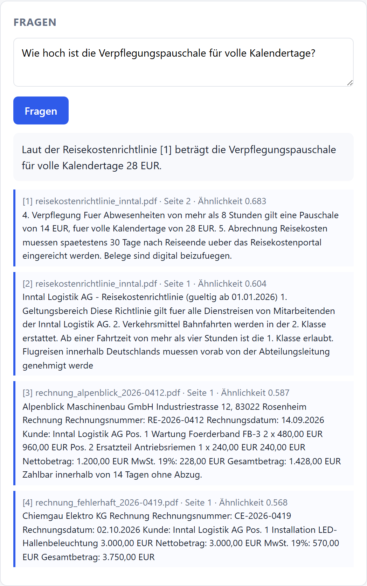
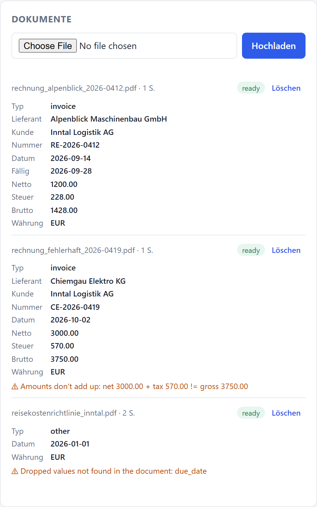
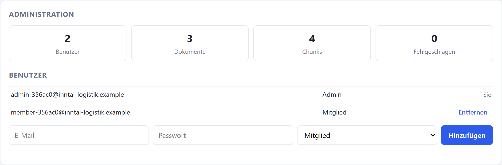
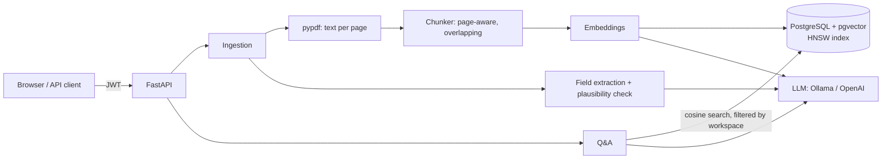

# DocuQuery

**Ask questions about your business documents and get answers with page-level citations — plus automatic field extraction for invoices.**

Multi-tenant RAG backend built with FastAPI, PostgreSQL + pgvector and any OpenAI-compatible LLM (runs fully local with Ollama).


> 🇩🇪 Kurzfassung unten: [Deutsch](#deutsch)

| Answer with page citations | Extracted invoice fields + plausibility check |
|---|---|
|  |  |

<details><summary>Admin panel (workspace stats, user management)</summary>



</details>

## What it does

- **Document Q&A (RAG):** upload PDFs, ask questions in German or English, get answers that cite the exact document and page. If the documents don't contain the answer, it says so instead of guessing.
- **Field extraction:** pulls vendor, document number, dates, net/tax/gross amounts from invoices. The LLM extracts, Pydantic validates, values the document doesn't back up are dropped, regex rules fill gaps.
- **Plausibility checks:** flags invoices where `net + tax ≠ gross` — the kind of error that slips through manual accounts-payable checks.
- **Multi-tenancy:** every company gets its own workspace. Data isolation is enforced in every query, including the vector search.
- **Auth & roles:** JWT login, `admin` and `member` roles, admins manage users and see workspace statistics.
- **Vendor-independent LLM layer:** Ollama (local, free, data never leaves the machine), OpenAI or any OpenAI-compatible server — switched by config only.

## Architecture



```
app/
├── main.py            FastAPI app, routers, static UI
├── config.py          all settings from environment variables
├── models.py          Workspace, User, Document, Chunk (pgvector column + HNSW index)
├── security.py        bcrypt, JWT, role dependencies
├── routers/           auth, documents + Q&A, admin
└── services/
    ├── pdf.py         text extraction
    ├── chunking.py    page-aware chunking with overlap
    ├── llm.py         provider interface (OpenAI-compatible + offline fake)
    ├── ingestion.py   PDF → chunks → embeddings → database
    ├── rag.py         retrieval + grounded answer with citations
    └── extraction.py  structured fields, rule fallback, plausibility checks
```

## Quick start

**With Docker (recommended):**

```bash
cp .env.example .env          # set JWT_SECRET
docker compose up --build     # first start downloads the Ollama models (~2.5 GB)
```

Open http://localhost:8000, create a workspace, upload a PDF. Interactive API docs: http://localhost:8000/docs

Sample documents (fictional invoices and a travel-expense policy):

```bash
pip install reportlab && python scripts/make_sample_docs.py
```

**Without Docker:** Python 3.11+, PostgreSQL 16 with the `vector` extension, and Ollama.

```bash
python -m venv .venv && source .venv/bin/activate
pip install -r requirements-dev.txt
ollama pull nomic-embed-text && ollama pull llama3.2
uvicorn app.main:app --reload
```

## API

| Method | Endpoint | Role | Purpose |
|---|---|---|---|
| POST | `/api/auth/register` | – | Create workspace, become its admin |
| POST | `/api/auth/login` | – | Get a JWT |
| POST | `/api/documents` | member | Upload + ingest a PDF |
| GET | `/api/documents` | member | List documents with extracted fields |
| DELETE | `/api/documents/{id}` | owner/admin | Delete a document and its vectors |
| POST | `/api/ask` | member | Question → answer + cited sources |
| GET/POST/DELETE | `/api/admin/users` | admin | Manage workspace users |
| GET | `/api/admin/stats` | admin | Users, documents, chunks, failures |

## Tests

```bash
docker run -d --name dq-test-pg -e POSTGRES_USER=app -e POSTGRES_PASSWORD=app \
  -e POSTGRES_DB=docuquery_test -p 5432:5432 pgvector/pgvector:pg16
pytest -q      # set DATABASE_URL if your test database isn't on localhost:5432
```

22 tests. The API tests run against a **real PostgreSQL + pgvector** (not mocks) and cover ingestion, citations pointing to the right page, extraction, plausibility warnings, workspace isolation and role permissions. The LLM is replaced by a deterministic offline provider, so tests are fast and free. CI runs them on every push.

## Evaluation

Unit tests prove the plumbing; they don't tell you whether a real model cites the right page. [`scripts/eval.py`](scripts/eval.py) asks 10 questions (9 German, 1 English) over the sample documents through the live API. A question counts as correct only if the answer **cites** (`[n]`) a source on the expected document and page.

Result with the default local setup (Ollama, `llama3.2` 3B + `nomic-embed-text`, CPU only):

| Metric | Result |
|---|---|
| Correct page cited in the answer | **8 / 10** |
| Retrieval hit@1 (top source is the right page) | 8 / 10 |
| Invoice fields extracted correctly (2 invoices) | 2 / 2, faulty totals flagged |

What goes wrong is as useful as the score:
- **Retrieval, 2 misses:** the two pages of the travel policy are close in embedding space. For *"Innerhalb welcher Frist müssen Reisekosten eingereicht werden?"* page 1 outranks page 2 and the model cites it, although the answer (30 days) is right; for the flight-approval question the right page is only rank 2, but the model still cites it. Pure vector search ignores exact terms like "eingereicht"; hybrid search (BM25 + vectors) is the fix on the roadmap.
- **Generation, 1 miss:** the 3B model sometimes gives a correct answer **without any citation marker**; which question this hits varies between runs (repeated runs scored 8/10 each time). A larger model (or `gpt-4o-mini` via config) reduces this; citations to non-existent sources are already stripped server-side.

```bash
docker compose up --build
python scripts/make_sample_docs.py && python scripts/eval.py
```

## Design decisions

- **`workspace_id` stored on every chunk.** The vector search filters by tenant without a join, and it's impossible to write a similarity query that forgets the tenant filter by accident. Cross-tenant requests return `404`, not `403`, so the existence of other tenants' documents isn't leaked.
- **Chunks never cross page boundaries.** Slightly more chunks, but every citation points to one exact page — which is what a user needs to verify an answer.
- **Overlap between chunks** keeps facts that sit on a cut (e.g. a label and its value) retrievable.
- **Similarity threshold before calling the LLM.** If nothing relevant is found, the model isn't asked at all: no hallucinated answer, no wasted tokens.
- **LLM + rules for extraction.** LLMs are good at layout variety, rules are deterministic. Combining them keeps extraction working even when the model is down or returns invalid JSON.
- **LLM output is checked against the document.** Vendor, customer and document number must appear verbatim in the text; a due date needs a payment term ("zahlbar", "due") to exist. Otherwise the value is dropped with a visible warning. A missing field is cheap to fill in by hand; a confidently wrong one gets paid. (Found by the live test: the 3B model invented a due date for a travel policy.)
- **Only checkable citations reach the user.** Markers like `[5]` with only four sources are removed, so every citation in the UI links to a real excerpt.
- **pgvector instead of a separate vector database.** One database for relational data and vectors: transactions, backups and tenant filters in one place. An HNSW index keeps search fast as data grows.
- **Provider interface for the LLM.** Switching from local Ollama to a cloud API is a config change — relevant when customers require on-premise processing for confidential documents.

## Limitations

- Ingestion is synchronous: a large PDF blocks its upload request until all embeddings are computed.
- Only PDFs with a text layer; scans fail with a clear error message.
- The similarity threshold is tuned loosely; with `nomic-embed-text`, unrelated chunks still score ~0.5, so the source list can include low-relevance excerpts.
- Schema is created with `create_all`, no migrations yet.

## Roadmap

- OCR for scanned PDFs (text layer is currently required)
- Background job queue for large uploads
- Alembic migrations
- Hybrid search (BM25 + vectors) and re-ranking
- Azure OpenAI provider

## Deutsch

**DocuQuery** beantwortet Fragen zu Geschäftsdokumenten (Rechnungen, Richtlinien, Verträge) mit Quellenangabe bis auf die Seite und extrahiert automatisch Rechnungsfelder (Lieferant, Nummer, Datum, Netto/Steuer/Brutto). Eine Plausibilitätsprüfung markiert Rechnungen, bei denen Netto + Steuer ≠ Brutto ist; vom Modell erfundene Werte, die nicht im Dokument stehen, werden verworfen. In der Evaluation mit einem lokalen 3B-Modell zitieren 8 von 10 Antworten die richtige Seite.

Technisch: mandantenfähiges RAG-Backend mit FastAPI, PostgreSQL + pgvector (HNSW-Index), JWT-Authentifizierung mit Rollen (Admin/Mitglied) und austauschbarem LLM-Anbieter — lokal mit Ollama, sodass vertrauliche Dokumente das eigene System nicht verlassen. Tests laufen gegen eine echte Datenbank, CI über GitHub Actions.

---

Built with AI-assisted development (Claude Code); architecture, design decisions, evaluation and review by me.

Built by **Muftah Elzawi** · [LinkedIn](https://linkedin.com/in/muftah-elzawi) · MIT License
